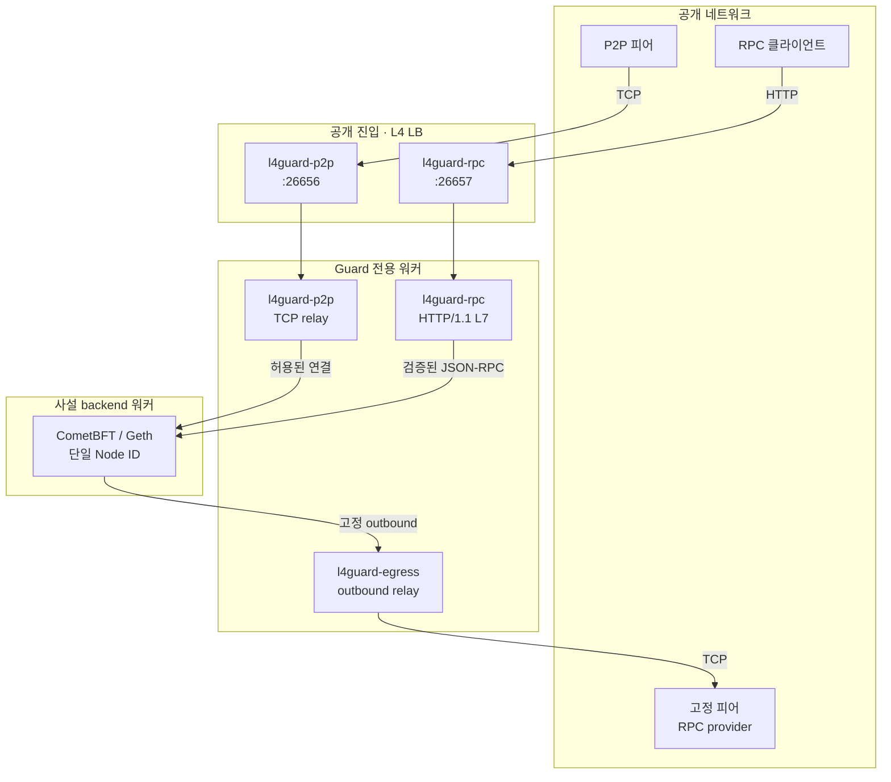
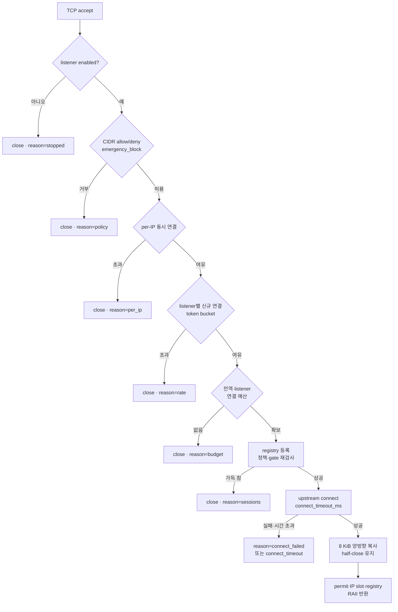

# l4guard

블록체인 노드 앞에서 동작하는 **L4 TCP 가드 프록시**다. 외부 연결을 Guard가
종단하고 backend 노드로는 별도의 연결을 새로 만든다. 연결 수·속도·출발지
주소를 제한하고, 필요하면 HTTP/1.1 JSON-RPC 요청을 검사한 뒤 전달한다.
Guard 프로세스는 상태를 저장하지 않으며, 장애가 나도 backend 프로세스와
데이터는 그대로 유지된다.

- 같은 바이너리를 P2P, RPC, 고정 egress listener로 재사용한다.
- 설정 파일 하나로 CometBFT·Geth 등 여러 체인 프로파일을 운영한다.
- 정책·quota·listener 상태는 `SIGHUP`으로 재시작 없이 교체한다.
- 잘못된 설정은 기동을 중단하거나 reload를 거부한다(fail-closed).

## 오버뷰



Guard는 공개 트래픽과 backend 사이의 유일한 진입점이다. backend Service는
`ClusterIP`로만 노출하고, 공개 LoadBalancer는 Guard 워커만 대상으로 한다.
노드가 먼저 연결하는 고정 peer·state-sync RPC도 같은 바이너리의 사설
listener를 거치게 해 외부 통신 경로를 한 곳으로 모은다.

### 연결 처리 순서



모든 검사를 통과한 연결만 세션 task가 된다. 거절된 연결은 task를 만들지
않고 즉시 닫히며, 세션 task는 정상 종료·오류·취소·abort 어느 경우에도
RAII로 예산을 반환한다. IP별 상한은 listener의 rate bucket보다 먼저
검사하므로, 이미 상한에 도달한 출발지가 다른 출발지용 토큰을 소모하지
못한다.

## 주요 기능

| 영역 | 내용 |
|---|---|
| L4 입장 제어 | IPv4/IPv6 CIDR allow/deny(deny 우선), 전역·listener별·IP별 동시 연결, listener별 신규 연결 token bucket |
| 세션 관리 | 세션 registry, 정책 변경·listener 중지·종료 시 즉시 취소, drain 후 강제 취소 |
| Hot reload | 정책·quota·listener `enabled`를 원자적으로 교체, 실패 시 마지막 정상 정책 유지 |
| 장애 격리 | upstream connect deadline, 8 KiB 복사 버퍼, half-close 보존, listener별 대역폭 예산 |
| L7 검사 | HTTP/1.1 요청 1개/연결, GET·POST만 허용, 정확한 method allow/deny, 비싼 method rate·동시성 quota |
| 관측 | 구조화 로그, bounded logging, 선택적 Prometheus `/metrics`, `/healthz`, `/readyz` |
| 배포 | Guard 전용 워커, 리스너별 Deployment, fail-closed NetworkPolicy, PDB, `maxSurge: 0` |
| 체인 호환 | CometBFT/Geth 고정 peer egress, state-sync RPC TLS/SNI pass-through, Geth UDP discovery 미지원 |

### Fail-closed 기본값

- `policy.allow`가 비어 있으면 모든 출발지를 거부한다.
- L7 listener의 `allow_methods`가 비어 있으면 모든 method를 거부한다.
- 설정 파싱·검증 실패 시 기동하지 않거나 마지막 정상 정책을 유지한다.
- 중지된 listener는 socket을 계속 bind한 채 새 연결을 즉시 닫는다.
- backend로 향하는 직접 경로가 없어야 하며, Guard가 죽어도 backend는 계속
  동작한다.

## 빠른 시작

Rust 1.85 이상이 필요하다.

```sh
git clone https://github.com/myuksal/l4guard.git
cd l4guard

cp guard.toml.example guard.toml
# listener·upstream·allow/deny를 환경에 맞게 수정

# 소켓을 열지 않고 설정만 검증
cargo run -- --check-config guard.toml

# 실행
make run RUN_ARGS="--config guard.toml"
# 또는
cargo run --release -- --config guard.toml
```

정책을 바꾼 뒤에는 프로세스를 재시작하지 않고 reload한다.

```sh
kill -HUP "$(pgrep -f 'l4guard --config')"
```

종료는 `SIGINT`/`SIGTERM`이다. 신규 accept를 멈추고 `drain_timeout_ms`
동안 정상 종료를 기다린 뒤 남은 세션을 취소한다.

### 최소 설정 예시

```toml
[limits]
max_connections = 256
max_connections_per_listener = 256
max_connections_per_ip = 8
max_new_connections_per_second = 50
new_connection_burst = 100

[policy]
allow = ["0.0.0.0/0", "::/0"]
deny = []
emergency_block = false

[[upstreams]]
name = "cometbft-p2p"
address = "10.0.0.5:26656"

[[listeners]]
name = "cometbft-p2p-public"
listen = "0.0.0.0:26656"
mode = "inbound"
upstream = "cometbft-p2p"
enabled = true
```

전체 항목과 주석은 [`guard.toml.example`](guard.toml.example)에 있다.

### Reload 범위

| 구분 | 설정 |
|---|---|
| Hot reload | `policy.allow`, `policy.deny`, `policy.emergency_block`, `limits.max_connections_per_ip`, `limits.max_new_connections_per_second`, `limits.new_connection_burst`, `listeners[].enabled` |
| 재시작 필요 | listener 주소·mode·upstream, `listeners[].l7`, `upstreams`, 연결 예산, timeout, registry·IP map 상한, 대역폭, `observe` |

재시작이 필요한 값을 바꾼 reload는 거부되고 마지막 정상 정책이 유지된다.
순차 재배포로 반영한다. 자세한 절차는 [`docs/policy.md`](docs/policy.md)를
따른다.

## HTTP L7 검사

RPC listener에 `[listeners.l7]`을 추가하면 HTTP/1.1 요청을 검사한다.
설정하지 않은 listener는 기존처럼 바이트를 그대로 중계한다.

```toml
[[listeners]]
name = "rpc-public"
listen = "0.0.0.0:26657"
mode = "inbound"
upstream = "rpc-node"

[listeners.l7]
max_header_bytes = 16384
max_header_count = 64
header_timeout_ms = 5000
max_body_bytes = 1048576
body_timeout_ms = 10000
max_json_depth = 32
max_json_array = 256
max_batch = 32
allow_methods = ["eth_call", "eth_getLogs", "eth_blockNumber", "status"]
deny_methods = ["debug_traceCall"]

[listeners.l7.expensive_methods.eth_call]
rate_per_second = 20
concurrent = 8
```

- 연결마다 요청 하나를 처리하고 `Connection: close`로 전달한다.
- `GET`과 `POST`만 허용하며 `CONNECT`, `Upgrade`, 압축 body, `chunked`
  이외의 transfer coding은 거부한다.
- method 이름은 JSON escape를 디코딩한 뒤 정확히 비교한다.
- 비싼 method는 전송 전에 rate token과 동시성 permit을 차감하고, 응답이
  끝날 때까지 permit을 보유한다.
- 요청은 client header를 복사하지 않고 새로 만든다. 응답은 그대로
  streaming한다.
- WebSocket JSON-RPC는 지원하지 않는다.

상세 규칙과 거부 사유는 [`docs/l7.md`](docs/l7.md)에 있다.

## 관측

기본 노출은 stderr 구조화 로그다. Prometheus 형식이 필요하면 endpoint를
켠다.

```toml
[observe]
level = "info"
log_rate_limit_per_second = 100
log_queue_capacity = 1024
metrics_listen = "127.0.0.1:9100"
```

```sh
curl -s http://127.0.0.1:9100/metrics
curl -s http://127.0.0.1:9100/healthz
curl -s http://127.0.0.1:9100/readyz
```

주요 지표:

- `l4guard_active_sessions`, `l4guard_ip_entries`
- `l4guard_accepted_total`
- `l4guard_rejected_total{reason="policy|budget|per_ip|rate|stopped|sessions"}`
- `l4guard_upstream_failures_total{reason="connect|timeout"}`
- `l4guard_bytes_total{direction="upstream|client"}`
- `l4guard_policy_version`
- `l4guard_l7_requests_total`, `l4guard_l7_forwarded_total`,
  `l4guard_l7_rejected_total{reason="..."}`

`l4guard_policy_version`은 입장 관련 설정의 결정적 digest다. 같은 설정을
쓰는 복제본은 재시작 여부와 관계없이 같은 값을 보고하므로, 모든 Guard가
동일 정책을 적용했는지 비교할 수 있다. Quota와 지표는 **복제본별** 값이므로
전체 트래픽은 복제본 합으로 계산한다.

로그는 1초 고정 창과 bounded queue로 제한한다. 상한을 넘은 이벤트는
버리고 초당 최대 1회 요약 줄만 남기므로, 거절 폭주가 Guard 자체를 멈추게
하지 않는다. 상세 내용은 [`docs/observe.md`](docs/observe.md)를 따른다.

## Kubernetes 배포

```sh
docker build -t ghcr.io/example/l4guard:0.1.0 .
docker push ghcr.io/example/l4guard:0.1.0

kubectl label node guard-a l4guard.io/role=guard
kubectl label node guard-b l4guard.io/role=guard
kubectl taint node guard-a l4guard.io/guard=true:NoSchedule
kubectl taint node guard-b l4guard.io/guard=true:NoSchedule

kubectl apply -k deploy/backend
kubectl apply -k deploy/base
```

`deploy/base`는 공개 P2P, 공개 RPC, 사설 egress를 각각 별도 Deployment로
배포한다. 같은 바이너리를 설정만 바꿔 재사용하며, 한 체인의 부하가 다른
경로에 번지지 않게 자원·교체 예산을 분리한다.

운영 원칙:

- backend Service는 `ClusterIP`만 사용한다. `NodePort`, `LoadBalancer`,
  `hostPort`를 쓰지 않는다.
- 공개 LoadBalancer는 Guard 워커만 대상으로 하고
  `externalTrafficPolicy: Local`을 유지한다.
- Guard readiness는 backend 상태를 기다리지 않는다.
- 공개 P2P endpoint 하나는 backend Node ID 하나에 대응한다.
- Guard와 backend를 서로 다른 워커에 배치해 커널 장애 범위를 분리한다.

체인별 설정 예시는 [`deploy/chains/cometbft`](deploy/chains/cometbft),
[`deploy/chains/geth`](deploy/chains/geth)에 있다. 배포 절차와 체크리스트는
[`docs/deploy.md`](docs/deploy.md), 체인 호환성은
[`docs/e8.md`](docs/e8.md)를 따른다.

## 검증

```sh
make check        # fmt + clippy + test
make manifests    # kustomize 렌더링 확인
make e8-check     # TLS/SNI pass-through + 실제 CometBFT block sync
make e9-check     # 부하·긴급 차단·우회·교체·RPC 정책·복제본 일관성
make e9-recovery  # 실제 CometBFT 교체·회복 시간 측정
```

- `scripts/e9-verify.py`: 256 연결 폭주에서 승인된 세션만 task를 만들고,
  예산·rate·IP 상한으로 나머지를 거부하는지 확인한다. 긴급 차단, listener
  중지·재개, manifest/IPv6/UDP 우회, Guard 교체, RPC 정책 우회, 복제본 정책
  버전 일관성을 함께 시험한다.
- `scripts/e9-cometbft-recovery.sh`: validator/full node를 띄우고 Guard를
  제거·교체해 peer 재접속, head lag 회복, Guard 경유 RPC 성공률을 측정한다.
- `scripts/e8-cometbft-sync.sh`: 실제 CometBFT full node가 Guard를 통해
  block sync를 완료하는지 확인한다.
- `scripts/e8-tls-passthrough.py`: state-sync RPC의 TLS/SNI가 Guard를 거쳐도
  보존되는지 확인한다.

측정 결과와 canary 순서는 [`docs/e9.md`](docs/e9.md)에 기록되어 있다.

## 제약과 비목표

- Geth UDP discovery는 지원하지 않는다. 고정 peer와 `NetRestrict`로
  운영한다.
- PROXY protocol은 수신하지 않는다. 비종단 L4 LB와
  `externalTrafficPolicy: Local`로 실제 client IP를 보존한다.
- L7 listener는 연결당 요청 하나만 처리하며 WebSocket을 지원하지 않는다.
- L7은 backend 응답을 검사하지 않는다. 요청의 형태와 양만 제한한다.
- 세션 전체에 대한 timeout은 두지 않는다. P2P 장기 연결을 허용하고,
  upstream connect deadline만 적용한다.
- 연결 예산과 rate limit은 분산 카운터가 아니다. backend가 받는 총량은
  Guard 복제본 수에 비례한다.
- CometBFT state-sync 검증 RPC는 backend의 provider별 `hostAliases`로
  Guard 사설 listener를 가리키게 한다. Guard는 TLS를 종단하지 않는다.

## 문서

| 문서 | 내용 |
|---|---|
| [`plan.md`](plan.md) | 설계 배경, 보호 범위, 배포 구조 |
| [`docs/policy.md`](docs/policy.md) | 정책 엔진, hot reload, 긴급 차단, quota 산정 |
| [`docs/l7.md`](docs/l7.md) | HTTP/1.1 JSON-RPC 검사 규칙과 거부 사유 |
| [`docs/observe.md`](docs/observe.md) | 지표 정의, 로그 상한, 민감정보 처리 |
| [`docs/deploy.md`](docs/deploy.md) | Kubernetes 자산과 fail-closed 체크리스트 |
| [`docs/e8.md`](docs/e8.md) | CometBFT/Geth 호환성, 고정 egress, state-sync RPC |
| [`docs/e9.md`](docs/e9.md) | 부하·장애·우회 검증 결과와 canary 절차 |
| [`AGENTS.md`](AGENTS.md) | 저장소 구조, 명령, 코드 규칙 |
