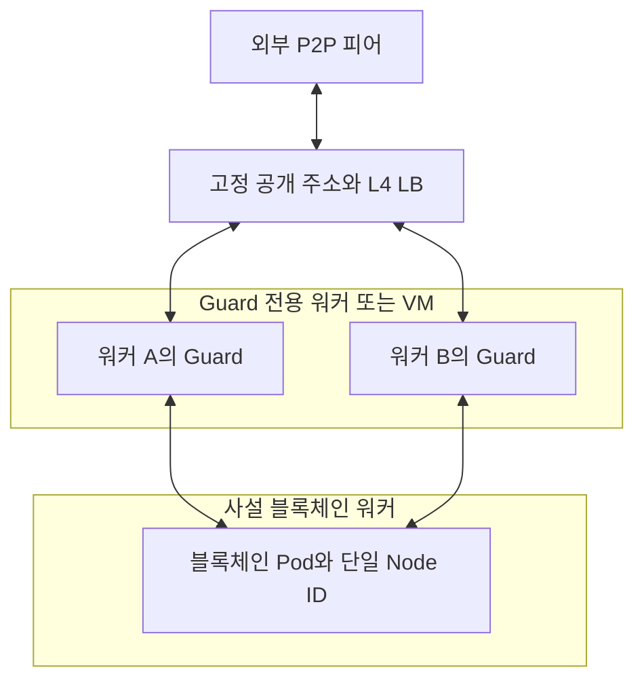

개발 방향은 **Rust로 작은 TCP 종단 프록시를 만들고, HTTP RPC 검사 기능을 선택적으로 추가하는 구조**로 잡는 것이 적합합니다. 하나의 바이너리를 여러 체인에 재사용하고, 체인별 차이는 설정과 배포 프로파일로 처리합니다.

다만 기대하는 효과를 얻으려면 다음 세 가지가 설계에 들어가야 합니다.

1. **Rust가 대신 처리하는 단계와 backend까지 전달되는 입력을 구분한다.**
2. **커널 장애를 격리하려면 Guard와 블록체인 노드를 서로 다른 워커에 배치한다.**
3. **노드가 먼저 연결하는 outbound 경로도 Guard를 경유하도록 설계한다.**

설정 초안, 구현 범위, 배포 절차, 인수 시험까지 포함한 [개발 계획서](https://chatgpt.com/space/page_33f6fb0e28e0819193e1b03c7a8ab0bb)를 작성했습니다. 주요 설계와 개발 순서는 아래와 같습니다.

---

## 1. 프로젝트의 목표와 보호 범위

프로젝트의 목표를 다음처럼 정의하겠습니다.

> **블록체인 노드로 들어오는 연결과 자원 사용을 제한하고, 취약점이 공개되었을 때 빠르게 적용할 임시 차단 수단을 제공하며, 외부 통신 계층의 장애와 교체를 블록체인 프로세스·데이터에서 분리한다.**

이 목표라면 작은 범용 프록시로도 의미 있는 효과를 얻을 수 있습니다.

### Rust가 보완하는 지점

핵심은 **취약한 입력 처리 단계가 어디에서 실행되는가**입니다.

| 취약점·공격 위치 | Rust TCP 프록시만으로 얻는 효과 | 남는 문제 |
|---|---|---|
| 과도한 신규 연결·동시 연결 | backend로 전달할 연결 수와 속도를 제한 | Guard 앞단의 회선·커널 자원은 별도 보호 필요 |
| 외부 TCP/IP 패킷 처리 | 외부 TCP를 종단하고 backend에 새 연결 생성 | backend 커널 전체가 안전해지는 것은 아님 |
| Go의 TLS 처리 | TLS를 그대로 통과시키면 해당 입력도 전달 | TLS 처리 경로를 바꾸려면 Guard 측 종단 필요 |
| Go의 HTTP 처리 | HTTP 바이트를 그대로 전달하면 해당 입력도 전달 | HTTP를 파싱·검증하고 새 요청으로 만들어야 입력 경계가 달라짐 |
| P2P handshake·메시지 파서 | 연결 빈도와 양은 제한 가능 | 허용된 연결의 악성 메시지는 backend에 도달 |
| 스냅샷 복원·체인 애플리케이션 로직 | 전송량과 연결을 제한 | 내용에 의한 취약점은 해당 소프트웨어 패치 필요 |

예를 들어 **Rust Guard에서 TCP를 받아 그대로 복사하면, Go의 HTTP/2 파서를 자극하는 입력도 그대로 전달될 수 있습니다.** 실제 Go HTTP/2 Rapid Reset 취약점은 HTTP/2 요청 처리 단계의 자원 고갈 문제였습니다. 이런 유형은 외부 HTTP/2를 제한하거나 별도 HTTP 종단 계층에서 처리해야 방어 경계가 달라집니다. 이는 해당 취약점과 프록시 구조를 연결한 설계적 판단입니다. [Go Packages](https://pkg.go.dev/vuln/GO-2023-2102?utm_source=chatgpt.com)

따라서 이 프로젝트에서는 다음 효과를 각각 구분해 관리해야 합니다.

- **L4:** 연결·주소·바이트량 통제, 외부 TCP 연결 종단.
- **HTTP L7:** HTTP 입력 정규화, RPC method 차단, 요청 비용 제한.
- **배포 구조:** Guard 워커 장애와 backend 워커 장애의 범위 분리.

### 커널 대응에는 워커 분리가 필요

일반 컨테이너는 호스트 커널을 공유합니다. Guard Pod와 블록체인 Pod가 같은 워커에 있으면, Pod를 나눠도 커널 장애는 함께 영향을 줄 수 있습니다. [Kubernetes](https://kubernetes.io/docs/concepts/security/multi-tenancy/?utm_source=chatgpt.com)

사용자가 생각한 “Guard만 빠르게 새 노드에서 재시작”하는 전략은 다음 조건에서 유효합니다.

- Guard와 backend가 다른 워커 또는 VM에 있다.
- backend 워커에 외부 패킷이 직접 도달하는 경로가 없다.
- 새 Guard 워커는 **패치되었거나 해당 취약점의 영향을 받지 않는 커널 이미지**를 사용한다.
- 기존 Guard 연결이 끊긴 뒤 피어들이 재연결할 수 있다.

같은 취약 커널의 새 Pod로 재시작하면 일시적인 복구는 가능해도 동일 공격에 다시 노출됩니다.

---

## 2. 공통 코어는 TCP로 만들되, 실제 통신 경로를 먼저 분리

CometBFT와 Geth는 P2P 내용을 암호화합니다.

- CometBFT의 일반적인 SecretConnection 기반 P2P는 TCP 위에서 인증과 암호화를 수행합니다.
- Geth의 RLPx 역시 TCP 기반 암호화 전송입니다.

따라서 단순 L4 Guard가 **메시지 종류, 트랜잭션 내용, snapshot chunk 내용, peer ID**를 일반적으로 읽고 필터링할 수 있다고 가정하면 안 됩니다. [GitHub](https://github.com/cometbft/cometbft/blob/main/spec/p2p/legacy-docs/peer.md?utm_source=chatgpt.com)

초기 지원 대상을 다음과 같이 나누겠습니다.

| 통신 경로 | 초기 처리 방식 |
|---|---|
| CometBFT P2P·block sync | TCP 중계 |
| CometBFT state sync의 snapshot·chunk | 동일 P2P 연결을 TCP 중계 |
| CometBFT state sync 검증용 외부 RPC | 별도 outbound 경유 경로 |
| CometBFT HTTP RPC | 선택적 HTTP L7 검사 |
| Geth `eth`·`snap` | TCP 중계 |
| Geth UDP discovery | 초기에는 끄고 고정 피어로 운영 |
| Geth HTTP RPC | 선택적 HTTP L7 검사 |
| WebSocket·Cosmos REST·gRPC·별도 snapshot 다운로드 | 각각 노출 여부를 기록하고 별도 지원 결정 |
| Engine API·ABCI·remote signer | 내부 통신으로 관리 |

여기서는 CometBFT의 기능을 **state sync**, Geth의 기능을 **snap sync**로 구분하겠습니다. CometBFT state sync는 P2P를 통한 스냅샷 수신과 외부 RPC를 통한 light-client 검증을 함께 사용합니다. Geth snap은 RLPx 위에서 동작하는 프로토콜입니다. [GitHub](https://github.com/cometbft/cometbft/blob/main/spec/abci/abci%2B%2B_app_requirements.md?utm_source=chatgpt.com)

**“P2P 포트 하나 앞에 Guard를 붙였다”와 “노드의 외부 통신을 모두 경유시켰다”는 별도의 완료 조건**으로 관리해야 합니다.

---

## 3. 권장 Kubernetes 구조

도식은 인바운드 경로입니다. 아웃바운드에도 같은 Guard 바이너리의 사설 리스너를 재사용합니다.

### 배포 단위

**같은 바이너리를 체인별 또는 장애 범위별 Deployment에 재사용**하는 것을 권장합니다.

예를 들어 CometBFT 계열 A 체인과 Geth 계열 B 체인이 같은 실행 파일을 사용하더라도, 각각 다른 설정과 자원 예산으로 실행합니다. 공개 RPC 부하가 크면 P2P와 RPC도 Deployment를 분리합니다.

이렇게 하면 여러 체인을 지원하기 위한 코드 분기는 줄이면서, 한 체인의 과부하가 모든 체인에 번지는 것을 제한할 수 있습니다.

### 공개 endpoint와 Node ID를 고정

P2P에서는 다음 원칙을 적용합니다.

> **하나의 공개 P2P endpoint는 하나의 backend Node ID에 대응한다.**

Guard 복제본 두 개가 동일한 backend 노드로 중계하는 구성은 가능하지만, 서로 다른 identity의 backend 노드 여러 개를 같은 endpoint 뒤에 무작위로 분산하는 구성은 피해야 합니다. CometBFT는 접속 주소에 포함된 peer ID와 실제 인증 키를 확인합니다. [GitHub](https://github.com/cometbft/cometbft/blob/main/spec/p2p/legacy-docs/peer.md?utm_source=chatgpt.com)

### backend 워커까지 외부 패킷이 들어오지 않게 구성

Guard를 `LoadBalancer`나 `NodePort`로 노출했다고 해서 외부 패킷이 Guard 워커에만 도착하는 것은 아닙니다. 일반적인 NodePort 구성은 여러 워커에 포트를 만듭니다. [Kubernetes](https://kubernetes.io/docs/concepts/services-networking/service/?utm_source=chatgpt.com)

따라서 다음을 함께 적용합니다.

- LB 대상은 Guard 워커로 제한.
- backend 워커는 사설 네트워크에 배치.
- 상위 방화벽에서 backend 워커로의 외부 진입 차단.
- backend Pod에는 필요한 Guard 출처와 내부 의존성만 허용.
- Guard 장애 시 backend 직통 우회 경로를 열지 않는 **fail-closed** 동작.

---

## 4. 최소 코드로 outbound까지 처리하는 방법

이 설계에서 가장 놓치기 쉬운 부분입니다.

블록체인 노드가 악성 피어에 먼저 연결해도, 그 연결은 양방향입니다. 해당 피어가 돌려주는 데이터는 backend로 들어옵니다. 인바운드 리스닝 포트에만 Guard를 붙였다면 이 경로는 Guard를 거치지 않습니다.

또한 **NetworkPolicy는 접근 허용을 제어하며, 임의 연결을 공통 프록시로 라우팅하는 기능은 아닙니다.** [Kubernetes](https://kubernetes.io/docs/concepts/services-networking/network-policies/?utm_source=chatgpt.com)

### 초기 운영 버전은 고정 피어별 relay

최소 구현으로는 다음 방식이 적합합니다.

| backend가 연결하는 주소 | Guard의 고정 목적지 |
|---|---|
| `guard-private:31001` | 실제 peer A의 P2P 주소 |
| `guard-private:31002` | 실제 peer B의 P2P 주소 |
| `guard-private:31003` | 실제 peer C의 P2P 주소 |

인바운드와 같은 TCP 중계 코드를 사용하고, 목적지만 설정으로 바꿉니다.

체인 설정에서는 다음을 적용합니다.

- **CometBFT:** 상대 peer ID는 유지하고 연결 주소를 사설 Guard 리스너로 변경. PEX·seed·기존 주소록의 자동 연결 경로 검토.
- **Geth:** 원래 enode 공개 키는 유지하고 IP·TCP 포트를 Guard 리스너로 변경. 초기에는 discovery를 끄고 static peers 사용.
- **네트워크:** backend의 직접 인터넷 연결은 차단하고 등록된 경유 경로만 허용.

Geth는 discovery 비활성화와 static peer 구성을 지원합니다. 다만 Guard 주소로 바꾼 구성이 실제 포크에서 정상 인증·동기화되는지는 초기 PoC로 확인해야 합니다. [go-ethereum](https://geth.ethereum.org/docs/fundamentals/peer-to-peer?utm_source=chatgpt.com)

### state-sync RPC도 별도 경유

CometBFT의 외부 RPC 서버도 등록된 경로를 거치게 합니다.

HTTPS를 그대로 중계할 경우에는 원래 hostname·SNI·Host·인증서 검증을 유지해야 합니다. 작은 구현으로 가능한 방법은 다음과 같습니다.

1. backend Pod에서만 해당 RPC hostname을 Guard 내부 endpoint로 해석.
2. provider마다 별도 내부 Service IP를 사용.
3. Guard는 원래 provider 주소로 연결.
4. Guard 자신의 이름 해석에는 backend용 재정의를 적용하지 않음.

이 방식은 **TCP 연결 통제와 경유**를 제공합니다. backend의 TLS·HTTP 응답 파서까지 대신 처리하는 것은 아니므로, 그 단계의 취약점을 줄이려면 별도 HTTP 종단 기능이 필요합니다.

### 동적 discovery는 별도 확장 단계

고정 피어 방식은 코드가 작지만 피어 관리 부담이 생깁니다. 운영자가 다른 독립 피어를 확보하고, 장애 시 교체하는 절차가 필요합니다.

임의 피어 탐색과 동적 outbound까지 지원하려면 원래 목적지 전달, 투명 프록시, 반환 경로, CNI 연동이 추가됩니다. 이 요구가 필수인 체인은 **0단계 PoC에서 바로 확인하고 일정에 반영**합니다.

---

## 5. 첫 번째 버전의 기능 명세

### 필수 기능

| 기능 | 구현할 내용 |
|---|---|
| TCP 중계 | 고정 listener → 고정 upstream |
| IP 정책 | IPv4·IPv6 CIDR allow/deny, deny 우선 |
| 동시 연결 제한 | 전체·리스너별·인바운드 IP별 상한 |
| 신규 연결률 제한 | token bucket과 burst 상한 |
| 대역폭 제한 | 리스너별·필요 시 연결별 양방향 byte budget |
| 자원 제한 | 연결 시도·상태 맵·로그 큐·세션 registry 크기 제한 |
| 타임아웃 | backend 연결 시도 deadline |
| 정책 갱신 | 검증 후 일괄 교체, 실패 시 기존 정책 유지 |
| 긴급 차단 | 신규 연결 차단과 해당 기존 세션 종료 |
| 종료 처리 | 신규 연결 중지, 제한된 drain, 자원 회수 |
| 관측 | 연결 수, 차단 사유, 전송량, 연결 실패, 정책 버전 |

### 작은 구현에서 반드시 지켜야 할 사항

**첫째, 연결 허가를 얻은 뒤 task를 생성합니다.**

연결마다 task를 먼저 만들고 그 안에서 semaphore를 기다리게 하면, 활성 연결 수를 제한해도 대기 task와 accepted socket이 계속 늘어날 수 있습니다.

권장 순서는 다음과 같습니다.

1. `accept`
2. 주소 정책 확인
3. 연결·신규 연결률 예산 확인
4. permit 획득
5. task 생성
6. upstream 연결
7. 양방향 복사
8. 종료 시 permit·카운터·세션 정보 반환

**둘째, 모든 상태에 상한을 둡니다.**

IP별 상태 맵은 TTL만으로 충분하지 않습니다. 최대 항목 수도 제한해야 합니다. 활동 중인 연결의 카운터를 임의로 지워 제한을 우회하게 만들지 않도록 합니다.

**셋째, P2P 연결의 전체 수명을 짧게 제한하지 않습니다.**

`timeout(60초, 양방향 복사)`는 idle timeout이 아니라 정상 P2P 연결을 60초마다 끊는 구현입니다. 초기에는 connect deadline과 연결 상한을 우선 사용하고, idle timeout이 필요하면 실제 I/O 활동을 추적합니다.

**넷째, 대역폭 제한은 backpressure로 처리합니다.**

TCP 스트림 중간의 바이트 일부를 버리고 계속 전달하면 암호화·framing이 깨집니다. 읽기를 늦추거나 연결을 종료해야 합니다.

**다섯째, outbound 복구용 연결 예산을 남깁니다.**

인바운드 공격이 전체 슬롯을 차지해 고정 피어로 재접속할 수 없게 만들면 가동률 목표와 충돌합니다. 공개 인바운드와 고정 피어 outbound에 별도 예산을 둡니다.

---

## 6. 블랙리스트는 기존 세션까지 종료해야 함

P2P 연결은 오래 유지되므로, 신규 연결만 차단하는 블랙리스트로는 대응이 늦을 수 있습니다.

초기 정책 시스템에는 다음 동작을 포함합니다.

- 설정 전체 파싱과 검증.
- 정상 정책을 한 번에 교체.
- 오류가 있으면 마지막 정상 정책 유지.
- 차단된 source 또는 target에 연결된 기존 세션 종료.
- listener 단위의 긴급 중지.
- 정책 변경과 새 연결 등록이 겹쳐도 차단을 놓치지 않도록 처리.
- 모든 Guard 복제본의 정책 버전 확인.

NetworkPolicy 변경이 기존 연결을 즉시 끊는지는 구현 의존이므로, 긴급 세션 종료는 Guard가 직접 담당하도록 합니다. [Kubernetes](https://kubernetes.io/docs/concepts/services-networking/network-policies/?utm_source=chatgpt.com)

운영을 작게 유지하기 위해 **TOML 파일 + 기존 GitOps/ConfigMap 배포**로 시작합니다.

Hot reload는 ACL·quota·긴급 중지 정책에 한정하고, listen 주소·upstream·프로토콜 모드 변경은 순차 재배포로 처리하면 코드가 단순해집니다.

구현(E4)에서는 `SIGHUP`으로 설정 파일 전체를 다시 검증한 뒤, reload 가능한 항목만 원자적으로 교체합니다. 주소 정책·IP별 상한·신규 연결률·listener `enabled`가 reload 대상이며, 연결 예산·listener socket·upstream·관측 설정은 재시작 대상입니다. 실패 시 마지막 정상 정책을 유지하고 경고 로그를 남깁니다. 각 정책 snapshot에는 복제본 간 비교용 `policy_version`을 부여합니다. Quota는 복제본별이므로 backend 방향 총량은 `복제본 수 × max_connections`로 산정하며, 상세 절차와 예산 공식은 `docs/policy.md`에 기록합니다.

또한 복제본별 quota라는 점을 명시해야 합니다. Guard 두 개에 각각 256개 제한을 두면 backend 방향 총량은 최대 512개가 될 수 있습니다. 초기에는 분산 카운터를 추가하기보다 복제본 수까지 포함해 예산을 정합니다.

---

## 7. HTTP L7은 제한된 JSON-RPC 검사로 시작

RPC에 대해서는 L7을 추가할 가치가 큽니다. Geth 공식 보안 문서도 공개 RPC를 운영할 때 프록시, application filtering, rate limiting 등의 통제를 권고합니다. [go-ethereum](https://geth.ethereum.org/docs/fundamentals/security?utm_source=chatgpt.com)

초기 지원 범위는 다음과 같이 잡겠습니다.

> **HTTP/1.1 JSON-RPC와 CometBFT의 HTTP URI 호출을 파싱하고, 정책을 통과한 요청만 새 upstream 요청으로 생성한다.**

### 검사 항목

| 항목 | 정책 |
|---|---|
| HTTP header | 크기·개수·수신 시간 제한 |
| Body | 누적 크기와 수신 시간 제한 |
| JSON | 깊이·배열 크기·모호한 중복 보안 키 제한 |
| Batch | 모든 항목 검사, 개수 제한, 항목별 quota 차감 |
| Method | 명시적 allowlist와 긴급 deny |
| 비싼 요청 | method별 요청률·동시 실행량 제한 |
| 압축 body | 초기에는 거부 |
| CONNECT·Upgrade | 초기 공개 listener에서 거부 |
| Upstream 전달 | 전체 검증 후 새 요청 생성 |
| 자동 재시도 | 이미 전송한 요청의 자동 재실행은 비활성 |

문자열 검색으로 `"debug_"` 같은 내용을 찾는 방식은 사용하지 않습니다. JSON escape, batch, URI 호출, parser 간 해석 차이를 처리해야 하기 때문입니다.

### CometBFT의 GET·POST·WS 우회 주의

CometBFT RPC는 같은 method를 다음 경로로 노출할 수 있습니다.

- GET URI 호출
- POST JSON-RPC
- WebSocket JSON-RPC

따라서 POST만 검사하고 GET이나 WS를 그대로 통과시키면 차단을 우회할 수 있습니다. 초기에는 GET·POST를 모두 검사하고 WS는 별도 지원 단계로 둡니다. [GitHub](https://github.com/cometbft/cometbft/blob/main/rpc/jsonrpc/doc.go?utm_source=chatgpt.com)

HTTP parser는 직접 만들지 않고 검증된 라이브러리를 사용합니다. Hyper의 header 제한과 body 누적 크기 제한은 별도로 설정해야 합니다. [Rust](https://docs.rs/hyper/latest/hyper/server/conn/http1/struct.Builder.html?utm_source=chatgpt.com)

`eth_call`, `eth_getLogs`처럼 정상적으로 허용한 method도 비용이 클 수 있습니다. 프록시 timeout만으로 backend 연산이 항상 중단되는 것은 아니므로 **보내기 전 동시 실행량 제한**을 우선 적용합니다.

---

## 8. 체인 호환성에서 반드시 검증할 문제

### 실제 peer IP가 backend에서 사라짐

일반 TCP 프록시는 backend에 새 연결을 만드므로 backend가 보는 주소는 Guard IP입니다.

이 때문에 CometBFT에서는 `allow_duplicate_ip` 설정이 중요합니다. 기본 구성은 같은 IP의 여러 peer를 제한하므로, private backend에 필요한 예외를 적용하고 실제 외부 IP별 제한은 Guard에서 담당해야 할 수 있습니다. [GitHub](https://github.com/cometbft/cometbft/blob/main/config/config.go?utm_source=chatgpt.com)

추가 검증 항목은 다음과 같습니다.

| CometBFT | Geth |
|---|---|
| `allow_duplicate_ip` | `NetRestrict` |
| `addr_book_strict` | static peer 주소 |
| `filter_peers` 또는 앱의 주소 필터 | LAN IP에 대한 inbound 제한 동작 |
| `external_address` | NAT·enode·ENR 광고 주소 |
| PEX·seed·기존 주소록 | discovery·bootnode 경로 |

Geth도 Guard의 사설 주소로 관측되면 기존 IP 기반 정책의 의미가 바뀝니다. 현재 공식 소스는 inbound 빈도 제한에서 LAN 주소를 다르게 취급합니다. [GitHub](https://github.com/ethereum/go-ethereum/blob/master/p2p/server.go?utm_source=chatgpt.com)

### Guard까지는 실제 source IP가 보여야 함

IP 블랙리스트가 의미 있으려면 Guard가 외부 client 주소를 정확히 받아야 합니다.

`externalTrafficPolicy: Local`만으로 모든 LB 환경에서 해결되지는 않습니다. 앞단 LB가 TCP 연결을 종단하면 Guard에는 LB 주소가 보일 수 있습니다. 이때는 신뢰한 LB에서만 PROXY protocol을 받는 방식 등을 검토합니다. [Kubernetes](https://kubernetes.io/docs/tutorials/services/source-ip/?utm_source=chatgpt.com)

PROXY header를 backend P2P 스트림 앞에 임의로 붙이는 것은 피해야 합니다. backend의 명시적 지원 없이 넣으면 handshake 데이터가 달라집니다.

### UDP discovery는 별도 기능

Geth discovery에는 UDP와 endpoint 검증이 사용됩니다. 주소·포트가 달라지는 중계가 피어 학습과 응답 경로에 영향을 줄 수 있으므로 “UDP도 복사하면 된다”는 수준으로 완료 처리하기 어렵습니다. [raw.githubusercontent.com](https://raw.githubusercontent.com/ethereum/devp2p/master/discv4.md?utm_source=chatgpt.com)

초기에는 고정 피어를 사용하고, UDP는 association 상한·TTL·반환 경로·주소 광고를 검증하는 별도 단계로 두겠습니다.

---

## 9. Rust 구현과 코드 규모

단일 crate를 유지하고 다음 정도로 나누면 됩니다.

| 모듈 | 역할 |
|---|---|
| `main` | 시작·signal·종료 |
| `config` | TOML 파싱과 검증 |
| `policy` | CIDR·quota·token bucket |
| `relay` | TCP 연결과 양방향 복사 |
| `sessions` | 활성 세션과 취소·회수 |
| `observe` | 제한된 로그와 metric |
| `rpc` | 선택적 HTTP L7 |

공통 코어의 의존성 후보는 `tokio`, `serde`, `toml`, `ipnet`, `tracing` 정도입니다. 세션 취소에는 `tokio-util`을 검토하고, RPC 기능에 HTTP·JSON·TLS 관련 의존성을 추가합니다.

바이트 중계는 Tokio의 `copy_bidirectional` 계열을 우선 사용합니다. 이 함수는 half-close를 처리하며 기본적으로 양방향에 각각 8 KiB 버퍼를 사용합니다. [Rust](https://docs.rs/tokio/latest/tokio/io/fn.copy_bidirectional.html?utm_source=chatgpt.com)

자체 L4 프로덕션 코드는 **약 1천~3천 줄을 범위 관리 목표**로 잡을 수 있습니다. 테스트·배포 파일·선택적 RPC는 별도입니다. 다만 코드 줄 수를 줄이기 위해 자원 회수나 오류 처리를 제거하면 안 됩니다.

초기 범위에서는 다음 구성 요소가 필요하지 않습니다.

- 중앙 제어 서버와 DB
- Kubernetes Operator·CRD
- 체인별 SDK
- 자체 TCP·암호·HTTP parser
- P2P 메시지 디코더
- 자동 평판·복잡한 규칙 실행 엔진

새 체인 편입은 **리스너·주소·제한값·배포 프로파일·호환성 결과**를 추가하는 방식으로 처리합니다.

---

## 10. 초기 사양과 운영 방식

아래는 **L4 Guard Pod 하나의 실험 시작값**입니다. 성능을 보장하는 최소 사양은 아닙니다.

| 항목 | 초기 실험값 |
|---|---:|
| CPU request | 100m |
| CPU 상한 실험 | 1 CPU |
| Memory request | 64 MiB |
| Memory limit | 256 MiB |
| 동시 연결 | 256개부터 시작 |
| 확대 시험 | 512개·1,024개 |
| 복사 버퍼 | 방향당 8 KiB |
| 초기 전송 부하 | 양방향 payload 합계 100 Mbps |

방향당 8 KiB라면 연결 256개의 복사 버퍼는 약 4 MiB입니다. 그러나 전체 메모리에는 task, 상태 맵, 연결당 두 socket, 커널 버퍼 등이 추가됩니다. **RSS만으로 사양을 정하지 않고 cgroup 메모리·FD·socket memory·conntrack도 함께 측정**합니다.

별도 워커의 kubelet·CNI·시스템 자원은 위 수치에 포함하지 않습니다. Guard 자체가 작아도 커널 격리를 위한 워커 운영비는 별도로 계산해야 합니다.

### Guard 교체 시 보장할 것

Guard가 상태를 거의 저장하지 않는다는 것은 재시작 때 체인 DB 복구가 필요 없다는 뜻입니다. 살아 있는 TCP 세션이 새 Guard로 이동한다는 뜻은 아닙니다.

따라서 교체 목표는 다음과 같습니다.

- backend 프로세스와 데이터 유지.
- 고정 공개 endpoint 유지.
- 정상 Guard를 통한 재접속.
- peer 수와 동기화 지연의 회복 시간 측정.

Guard 워커가 정확히 두 대이고 복제본 두 개를 서로 다른 워커에 강제 배치한다면, 세 번째 Pod를 만드는 rolling update가 막힐 수 있습니다. 초기에는 **`maxSurge: 0`, `maxUnavailable: 1`로 순차 교체**하거나, 새 워커를 먼저 추가해 배치 공간을 확보합니다.

또한 Guard readiness가 backend readiness를 기다리고, backend 시작이 Guard readiness를 기다리는 순환을 만들지 않도록 자체 준비 상태와 upstream 상태를 분리합니다.

---

## 11. 개발 일정과 완료 기준

**개발자 1명, 기존 Kubernetes·배포·관측 환경 활용**을 가정한 추정입니다.

| 단계 | 예상 | 완료 기준 |
|---|---:|---|
| 0. 경로·버전·PoC | 2~3일 | 실제 포트, inbound/outbound, source IP, 고정 피어 경유 확인 |
| 1. TCP 코어 | 3~4일 | 연결 상한, 양방향 복사, half-close, connect deadline, 자원 회수 |
| 2. 정책·Kubernetes | 3~4일 | hot reload, 기존 세션 종료, 계측, 배포와 접근 정책 |
| 3. 체인 호환성 | 3~5일 | CometBFT·Geth 인증, 주소 광고, 고정 egress, 실제 동기화 |
| 4. 부하·장애 검증 | 3~4일 | 자원 상한, 우회 차단, Guard 교체, canary |
| 5. HTTP L7 | 추가 1~2주 | GET·POST·batch 검사, 크기·동시성 제한, 정책 우회 시험 |
| 6. 동적 egress·UDP | 별도 산정 | 별도 PoC 후 지원 방식 결정 |

따라서 **초기 TCP 운영 버전은 약 3~4주, HTTP L7까지 포함하면 약 4~6주**로 계획하겠습니다. 실체인의 최초 동기화 대기와 인프라 조달은 별도입니다.

### 운영 투입 전 필수 시험

특히 다음 항목을 통과해야 합니다.

1. **동기화:** CometBFT block/state sync와 Geth snap sync 완료.
2. **자원 상한:** 과도한 연결 시도에서 task·map·FD·메모리가 무한히 증가하지 않음.
3. **긴급 차단:** 신규 연결과 기존 연결 모두 정책 적용.
4. **우회 차단:** backend 직통, outbound 직접 연결, IPv6·UDP 등 별도 경로 확인.
5. **장애 격리:** Guard 종료·워커 교체 중 backend 프로세스와 데이터 유지.
6. **참여 회복:** peer 수, head lag, RPC 성공률 회복 시간을 별도로 측정.
7. **RPC 정책:** batch·escape·중복 키·URI 변형·Upgrade로 차단 우회 불가.
8. **복제본 일관성:** 모든 Guard에서 동일한 정책 버전 적용.

운영 validator에 적용하기 전에는 비서명 full node에서 canary를 수행하는 순서로 잡습니다.

## 12. 첫 스프린트에서 확정할 작업

첫 스프린트의 산출물은 다음 다섯 가지로 정하겠습니다.

- **대표 CometBFT 체인 1개와 Geth 계열 체인 1개의 정확한 이미지·버전 고정**
- **실제 inbound·outbound·state-sync RPC·내부 의존성 경로 목록**
- **고정 listener → upstream 방식의 Rust TCP relay**
- **연결·상태 맵 상한과 기존 세션을 종료하는 정책 기능**
- **Guard 전용 워커 배치 및 backend 우회 차단 PoC**

이 단계에서 고정 피어 경유가 운영 요구를 충족하는지 먼저 판단합니다. 충족하면 작은 공통 코어를 유지한 채 체인을 늘리고, 동적 피어 탐색이 필수라면 해당 네트워크 작업을 다음 개발 단계의 필수 범위로 승격합니다.

*계획서 본문과 구조는 저장 후 확인했습니다. 문서에 포함된 Mermaid 도식의 앱 내 렌더링은 미확인입니다.*
