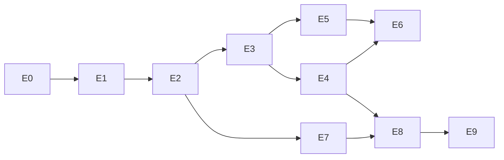

# l4guard 개발 계획 (Epic)

이 문서는 `plan.md`의 설계를 실제 작업 단위로 분해한 개발 계획이다.
기준 문서는 `plan.md`이며, 충돌이 있으면 `plan.md`를 우선한다.

## 1. 제품 목표

> 블록체인 노드로 들어오는 연결과 자원 사용을 제한하고, 취약점이 공개되었을 때 빠르게 적용할 임시 차단 수단을 제공하며, 외부 통신 계층의 장애와 교체를 블록체인 프로세스·데이터에서 분리한다.

단일 Rust 바이너리를 체인별 설정·배포 프로파일로 재사용한다. 체인별 코드 분기를 만들지 않는다.

### 완료 정의 (제품 수준)

1. 고정 listener → 고정 upstream TCP 릴레이가 실제 노드에서 동작한다.
2. 모든 외부 경로(인바운드·아웃바운드·RPC·IPv6·UDP)가 명시적으로 허용 또는 차단된다.
3. 정책 변경 시 신규 연결과 **기존 세션 모두**에 적용된다.
4. Guard 종료·교체 중에도 backend 프로세스와 데이터는 유지된다.
5. 과부하 상황에서 task·상태 map·FD·메모리가 상한을 넘지 않는다.
6. 선택 기능으로 HTTP L7 검사가 GET·POST·batch 우회를 막는다.

### 명시적 비목표 (초기 범위)

- 중앙 제어 서버·DB, Kubernetes Operator·CRD, 체인별 SDK
- 자체 TCP/암호/HTTP parser, P2P 메시지 디코더
- 자동 평판·복잡한 규칙 엔진
- P2P 메시지 내용 기반 필터링 (SecretConnection·RLPx로 암호화됨)
- 동적 peer discovery, UDP 중계 (M6 이후 별도 판단)

---

## 2. 마일스톤

| ID | 마일스톤 | 예상 | 완료 기준 | 대응 Epic |
|---|---|---:|---|---|
| M0 | 경로·버전·PoC | 2~3일 | 실제 포트·inbound/outbound·source IP·고정 피어 경유 확인 | E0 |
| M1 | TCP 코어 | 3~4일 | 연결 상한, 양방향 복사, half-close, connect deadline, 자원 회수 | E1, E2, E3 |
| M2 | 정책·Kubernetes | 3~4일 | hot reload, 기존 세션 종료, 계측, 배포와 접근 정책 | E4, E5, E7 |
| M3 | 체인 호환성 | 3~5일 | CometBFT·Geth 인증, 주소 광고, 고정 egress, 실제 동기화 | E8 |
| M4 | 부하·장애 검증 | 3~4일 | 자원 상한, 우회 차단, Guard 교체, canary | E9 |
| M5 | HTTP L7 | 추가 1~2주 | GET·POST·batch 검사, 크기·동시성 제한, 정책 우회 시험 | E6 |
| M6 | 동적 egress·UDP | 별도 산정 | 별도 PoC 후 지원 방식 결정 | — (백로그) |

- **초기 TCP 운영 버전:** 약 3~4주
- **HTTP L7 포함:** 약 4~6주 (개발자 1명, 기존 K8s·배포·관측 환경 활용 가정)

---

## 3. Epic 개요

| Epic | 이름 | 모듈 | 마일스톤 | 의존 |
|---|---|---|---|---|
| E0 | 경로·버전 확정 PoC | — | M0 | — |
| E1 | 설정 로딩과 검증 | `config` | M1 | E0 |
| E2 | TCP 릴레이 코어 | `relay` | M1 | E1 |
| E3 | 세션 수명과 자원 회수 | `sessions` | M1 | E2 |
| E4 | 정책 엔진과 hot reload | `policy` | M2 | E1, E3 |
| E5 | 관측과 제한된 로깅 | `observe` | M2 | E3 |
| E6 | HTTP L7 검사 | `rpc` | M5 | E4, E5 |
| E7 | 배포와 접근 통제 | 배포 자산 | M2 | E2 |
| E8 | 체인 호환성과 고정 egress | 설정·문서 | M3 | E7 |
| E9 | 부하·장애·우회 검증 | 테스트 | M4 | E8 |

---

## 4. Epic 상세

### E0. 경로·버전 확정 PoC

**목표:** 코드를 쓰기 전에 "고정 피어 경유"가 운영 요구를 충족하는지 판정한다. 결과가 부정적이면 M6 범위를 앞당긴다.

| ID | 작업 | 완료 기준 |
|---|---|---|
| E0-T1 | 대표 CometBFT 체인 1개, Geth 계열 체인 1개의 이미지·버전 고정 | `docs/chains.md`에 이미지 digest까지 기록 |
| E0-T2 | 실제 포트·프로토콜 인벤토리 | 노드별 listening/egress 포트 표 작성, 미확인 항목 명시 |
| E0-T3 | inbound/outbound/state-sync RPC/내부 의존성 경로 목록화 | 각 경로의 허용·차단 결정 기록 |
| E0-T4 | Guard 경유 시 실제 source IP 관측 확인 | LB 구성별로 Guard가 보는 주소와 `externalTrafficPolicy`/PROXY protocol 필요 여부 정리 |
| E0-T5 | 임시 `socat`/`nc` 수준 릴레이로 고정 피어 경유 인증·동기화 확인 | CometBFT P2P handshake 성공, Geth static peer 연결 로그 확보 |
| E0-T6 | 판정 회의 | "고정 피어로 충분/부족" 결론과 근거를 문서에 남김 |

**리스크:** discovery 비활성화 시 피어 수 부족으로 동기화 지연. → E0-T5에서 peer 수·head lag 기준 측정.

---

### E1. 설정 로딩과 검증

**목표:** TOML 설정을 파싱·검증하고, 잘못된 설정은 기동을 막는다(fail-closed).

| ID | 작업 | 완료 기준 |
|---|---|---|
| E1-T1 | 설정 스키마 정의 (`listeners`, `upstreams`, `limits`, `policy`, `observe`) | `serde` 구조체 + 문서화된 예제 `guard.toml` |
| E1-T2 | TOML 파싱과 기본값 | 누락 항목은 보수적 기본값(차단 우선, 작은 상한) |
| E1-T3 | 검증 규칙 | 잘못된 CIDR·0 상한·중복 listener 주소·미정의 upstream 참조를 기동 오류로 처리 |
| E1-T4 | 리스너별 모드 구분 | `inbound` / `outbound`(고정 목적지) 리스너를 같은 스키마에서 표현 |
| E1-T5 | 설정 스냅샷 타입 | 런타임이 `Arc<Config>` 형태로 읽고, 재로드 시 통째로 교체 가능한 구조 |
| E1-T6 | 오류 메시지 품질 | 실패 시 파일·키·이유를 한 줄로 출력, 비밀값 미노출 |

**제약:** listen 주소·upstream·프로토콜 모드 변경은 hot reload 대상이 아니다. 재배포로만 반영한다.

---

### E2. TCP 릴레이 코어

**목표:** 연결 허가를 받은 뒤에만 task를 만드는 릴레이 경로를 구현한다.

**고정 순서 (구현 계약):**
1. `accept`
2. 주소 정책 확인
3. 연결·신규 연결률 예산 확인
4. permit 획득
5. task 생성
6. upstream 연결
7. 양방향 복사
8. 종료 시 permit·카운터·세션 정보 반환

| ID | 작업 | 완료 기준 |
|---|---|---|
| E2-T1 | 리스너 루프 | accept 오류(EMFILE 등)에서 busy loop 없이 backoff |
| E2-T2 | permit 선획득 구조 | semaphore 대기 task·accepted socket이 무한히 쌓이지 않음 (대기 전에 거절) |
| E2-T3 | upstream 연결 + connect deadline | deadline 초과 시 세션 정리, 실패 사유 계측 |
| E2-T4 | 양방향 복사 | `copy_bidirectional` 계열 사용, 방향당 8 KiB 버퍼, half-close 보존 |
| E2-T5 | 종료 정리 | 정상/오류/취소 모든 경로에서 permit·counter·registry 반환 (RAII) |
| E2-T6 | idle timeout 도입 보류 | 전체 수명 `timeout()` 금지. 필요 시 실제 I/O 활동 기반으로만 |
| E2-T7 | 대역폭 제한 | 버퍼 일부 폐기 금지, 읽기 지연(backpressure) 또는 연결 종료만 허용 |
| E2-T8 | outbound 전용 예산 | 공개 인바운드와 고정 peer outbound 슬롯을 분리 |

**테스트:** loopback echo 서버로 half-close, 대용량 전송, 상한 초과 거절, deadline 초과를 검증.

---

### E3. 세션 수명과 자원 회수

**목표:** 활성 세션을 상한 내에서 추적하고, 정책에 의해 즉시 종료할 수 있는 기반을 만든다.

| ID | 작업 | 완료 기준 |
|---|---|---|
| E3-T1 | 세션 registry | `id → SessionMeta{listener, peer, upstream, cancel, started_at}` |
| E3-T2 | 상한 | registry 최대 항목 수 제한, 초과 시 신규 연결 거절 |
| E3-T3 | 취소 토큰 | `tokio-util` `CancellationToken`으로 복사 루프 즉시 중단 |
| E3-T4 | IP별 상태 map | TTL **과** 최대 항목 수 동시 적용, 활성 연결 카운터는 TTL로 삭제 금지 |
| E3-T5 | 종료 절차 | 신규 accept 중지 → listener 단위 drain(제한 시간) → 잔여 세션 취소 → 자원 회수 |
| E3-T6 | reload 경합 | 정책 교체와 신규 세션 등록이 겹쳐도 차단 누락 없음 (등록 시점 재검사) |

**테스트:** 등록 직후 정책 변경, 종료 중 신규 연결 시도, registry 포화 상황.

---

### E4. 정책 엔진과 hot reload

**목표:** 검증된 정책만 원자적으로 교체하고, 차단 대상의 기존 세션을 종료한다.

| ID | 작업 | 완료 기준 |
|---|---|---|
| E4-T1 | CIDR 정책 | IPv4·IPv6 allow/deny, **deny 우선** |
| E4-T2 | 동시 연결 제한 | 전체·리스너별·인바운드 IP별 상한 |
| E4-T3 | 신규 연결률 제한 | token bucket + burst 상한, IP별 상태 상한 동반 |
| E4-T4 | 긴급 차단 | 신규 차단 + 해당 기존 세션 즉시 종료 |
| E4-T5 | listener 단위 중지 | 특정 리스너만 중지/재개 |
| E4-T6 | reload 파이프라인 | 전체 파싱·검증 성공 시 일괄 교체, 실패 시 마지막 정상 정책 유지 + 경고 로그 |
| E4-T7 | 정책 버전 | 버전 번호 발급, 로그·metric에 노출, 복제본 간 비교 가능 |
| E4-T8 | 일관성 문서화 | 복제본별 quota임을 명시(2개 복제본 × 256 = 최대 512), 예산 산정식 문서화 |

**불변 조건 (AGENTS.md):** 정책 reload와 blacklist는 신규 연결뿐 아니라 **기존 세션도 종료**한다.

---

### E5. 관측과 제한된 로깅

**목표:** 운영 판단에 필요한 최소 지표를, 자체적으로 폭주하지 않는 형태로 제공한다.

| ID | 작업 | 완료 기준 |
|---|---|---|
| E5-T1 | 지표 정의 | 활성 연결, 거절 사유별 카운터, 송수신 바이트, upstream 실패, 정책 버전 |
| E5-T2 | 로그 상한 | 로그 큐 크기 제한, 초당 상한, 초과 시 요약 로그로 대체 |
| E5-T3 | 구조화 로그 | `tracing` 필드로 listener·peer·reason·version |
| E5-T4 | 노출 방식 | 기존 관측 환경에 붙일 수 있는 최소 형태(로그 기반 + 선택적 endpoint) |
| E5-T5 | 민감정보 | 설정·정책 전체 덤프 금지 |

---

### E6. HTTP L7 검사 (선택)

**목표:** HTTP/1.1 JSON-RPC와 CometBFT HTTP URI 호출을 파싱하고, 정책 통과 요청만 새 upstream 요청으로 재생성한다.

| ID | 작업 | 완료 기준 |
|---|---|---|
| E6-T1 | HTTP parser 채택 | 검증된 라이브러리 사용, header 크기·개수·수신 시간 제한 별도 설정 |
| E6-T2 | body 제한 | 누적 크기·수신 시간 상한, 초과 시 즉시 종료 |
| E6-T3 | JSON 검사 | 깊이·배열 크기·중복 보안 키(모호한 중복) 제한 |
| E6-T4 | batch | 모든 항목 검사, 개수 상한, 항목별 quota 차감 |
| E6-T5 | method 정책 | 명시적 allowlist + 긴급 deny |
| E6-T6 | 비싼 method | `eth_call`·`eth_getLogs` 등 요청률·**동시 실행량** 제한(전송 전 차감) |
| E6-T7 | 거부 목록 | 압축 body, `CONNECT`, `Upgrade`는 초기 공개 listener에서 거부 |
| E6-T8 | GET·POST 동시 검사 | CometBFT GET URI 호출도 검사, WS는 별도 단계로 명시적 미지원 |
| E6-T9 | 재작성 전달 | 전체 검증 후 새 요청 생성, 자동 재시도 비활성 |
| E6-T10 | 문자열 검색 금지 | `"debug_"` substring 매칭 방식 미사용 (테스트로 회귀 방지) |

**테스트:** batch 내 은닉 method, escape/유니코드 변형, 중복 키, URI 변형, 거대 header, chunked body, Upgrade 시도.

---

### E7. 배포와 접근 통제

**목표:** Guard 전용 워커 배치와 backend 우회 차단을 배포 자산으로 보장한다.

| ID | 작업 | 완료 기준 |
|---|---|---|
| E7-T1 | Deployment/Service 자산 | 리스너별 Deployment, `maxSurge: 0` / `maxUnavailable: 1` 순차 교체 |
| E7-T2 | LB 노출 | LB 대상은 Guard 워커로 제한, backend 워커는 사설망 |
| E7-T3 | 접근 정책 | backend Pod는 Guard 출처와 내부 의존성만 허용 |
| E7-T4 | fail-closed | Guard 장애 시 backend 직통 우회 경로 미개방 |
| E7-T5 | readiness 분리 | Guard readiness가 backend를 기다리지 않고, 그 역도 성립하지 않음 |
| E7-T6 | 자원 예산 | CPU 100m/1, mem 64MiB/256MiB에서 시작, cgroup·FD·socket memory·conntrack까지 측정 |
| E7-T7 | 공개 endpoint 규칙 | 하나의 공개 P2P endpoint = 하나의 backend Node ID (문서·매니페스트 주석) |

---

### E8. 체인 호환성과 고정 egress

**목표:** 실제 CometBFT·Geth 노드가 Guard 경유로 인증·동기화됨을 확인한다.

| ID | 작업 | 완료 기준 |
|---|---|---|
| E8-T1 | CometBFT 설정 | `allow_duplicate_ip`, `addr_book_strict`, `filter_peers`, `external_address`, PEX·seed·주소록 점검 결과 기록 |
| E8-T2 | Geth 설정 | `NetRestrict`, static peer, discovery 비활성, enode/ENR 광고 주소 점검 |
| E8-T3 | outbound 고정 relay | peer별 `guard-private:3100x → 실제 peer` 매핑 동작 |
| E8-T4 | state-sync RPC 경유 | hostname 재정의 → provider별 내부 Service IP → Guard가 원 주소로 연결, SNI/인증서 유지 |
| E8-T5 | Guard 자체 DNS | 재정의가 Guard 자신에게 적용되지 않음을 확인 |
| E8-T6 | 실제 동기화 | CometBFT block/state sync 완료, Geth snap sync 완료 |
| E8-T7 | PROXY protocol 검토 | 신뢰 LB 한정 수신 여부 결정, backend 스트림에 임의 부착 금지 |

---

### E9. 부하·장애·우회 검증

**목표:** 운영 투입 전 필수 시험을 모두 통과시키고 canary 절차를 만든다.

| ID | 작업 | 완료 기준 |
|---|---|---|
| E9-T1 | 연결 폭주 시험 | task·map·FD·메모리가 상한 내에서 평탄 |
| E9-T2 | 긴급 차단 시험 | 신규 + 기존 연결 모두 종료 |
| E9-T3 | 우회 차단 시험 | backend 직통, outbound 직접, IPv6, UDP 경로 확인 |
| E9-T4 | 교체 시험 | Guard 종료·워커 교체 중 backend 프로세스·데이터 유지, 재접속 확인 |
| E9-T5 | 회복 측정 | peer 수, head lag, RPC 성공률 회복 시간 별도 기록 |
| E9-T6 | RPC 정책 우회 시험 | batch·escape·중복 키·URI 변형·Upgrade (E6 이후) |
| E9-T7 | 복제본 일관성 | 모든 Guard에서 동일 정책 버전 적용 확인 |
| E9-T8 | canary | 비서명 full node에서 canary → validator 적용 순서 문서화 |

---

## 5. 횡단 요구사항 (모든 Epic 공통)

| 항목 | 규칙 |
|---|---|
| 자원 상한 | 모든 map·큐·registry에 최대 항목 수. TTL만으로 상한을 대체하지 않음 |
| fail-closed | 판단 불가·오류 시 차단 방향으로 실패 |
| 오류 처리 | `Option`=명백, `Result`=복구 가능, `panic!`=버그. `unwrap` 금지(`expect`) |
| unsafe | 금지. 불가피하면 `SAFETY:` 주석 + 근거 |
| 코드 스타일 | `@rust-style-guide` 준수, glob import 금지, free function은 `module::fn()` |
| 품질 게이트 | `cargo fmt --check`, `cargo clippy --all-targets --all-features -- -D warnings` 통과 |
| 의존성 | 코어는 `tokio`, `serde`, `toml`, `ipnet`, `tracing` (+ `tokio-util`). L7은 E6에서만 추가 |
| 규모 | 자체 L4 프로덕션 코드 1천~3천 줄 목표. 줄 수를 위해 자원 회수·오류 처리 제거 금지 |

---

## 6. 인수 시험 체크리스트 (운영 투입 전)

- [ ] **동기화:** CometBFT block/state sync, Geth snap sync 완료
- [ ] **자원 상한:** 과도한 연결 시도에서 task·map·FD·메모리 무한 증가 없음
- [ ] **긴급 차단:** 신규 연결과 기존 연결 모두 정책 적용
- [ ] **우회 차단:** backend 직통, outbound 직접, IPv6·UDP 등 별도 경로 확인
- [ ] **장애 격리:** Guard 종료·워커 교체 중 backend 프로세스·데이터 유지
- [ ] **참여 회복:** peer 수, head lag, RPC 성공률 회복 시간 측정
- [ ] **RPC 정책:** batch·escape·중복 키·URI 변형·Upgrade로 우회 불가
- [ ] **복제본 일관성:** 모든 Guard에서 동일 정책 버전

---

## 7. 미해결 결정 (Sprint 0에서 확정)

| ID | 질문 | 결정 시점 | 영향 |
|---|---|---|---|
| D1 | 실제 source IP 확보 방식: LB 종단 여부, PROXY protocol 수용 | E0-T4 | E2, E4, E7 |
| D2 | 고정 피어 경유로 운영 요구 충족 여부 | E0-T6 | M6 범위 승격 |
| D3 | WS·Cosmos REST·gRPC·별도 snapshot 다운로드 지원 여부 | M0 | E6, E8 |
| D4 | state-sync RPC provider별 내부 Service IP 운영 방식 | E8-T4 | E7, E8 |
| D5 | Geth discovery 완전 비활성의 동기화 품질 영향 | E0-T5 | E8 |
| D6 | metric 노출 방식(로그 전용 vs endpoint) | E5-T4 | E5, E7 |
| D7 | 복제본 quota 총량 예산 산정식 | E4-T8 | E7 |

---

## 8. 작업 순서 (첫 스프린트)

1. E0 (경로·버전·PoC)로 가정 검증 → D1·D2 확정
2. E1 + E2 로 "고정 listener → upstream Rust TCP relay" 최소 동작 확보
3. E3 + E4 로 연결·상태 상한과 기존 세션 종료 정책 확보
4. E7 로 Guard 전용 워커 배치 및 backend 우회 차단 PoC
5. E0-T6 판정에 따라 E8 또는 M6 승격 결정

**첫 스프린트 산출물:** 대표 체인 2종 버전 고정 · 경로 인벤토리 · 동작하는 TCP relay · 상한/세션 종료 정책 · 워커 배치·우회 차단 PoC

---

## 9. Definition of Done (모든 작업 공통)

- 기능이 코드·테스트·문서에 동시에 반영됨
- 상한·오류·종료 경로에 테스트가 존재함
- `cargo fmt --check`와 `clippy -D warnings` 통과
- `unwrap` 없음, `unsafe` 없음(또는 `SAFETY:` 근거)
- 동작 변경 시 `plan.md` 또는 `docs/` 갱신
